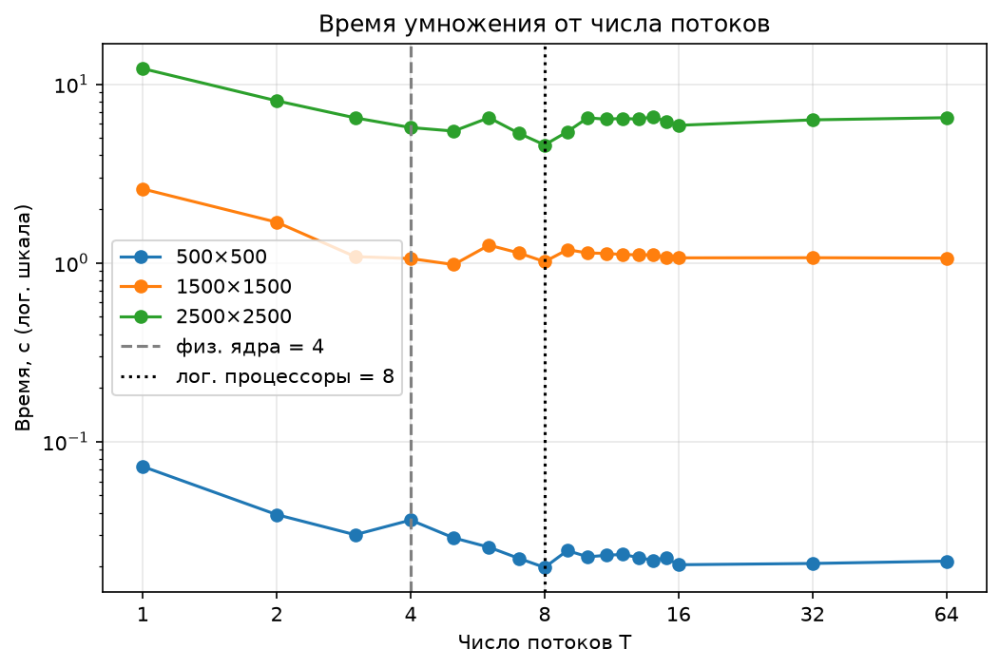
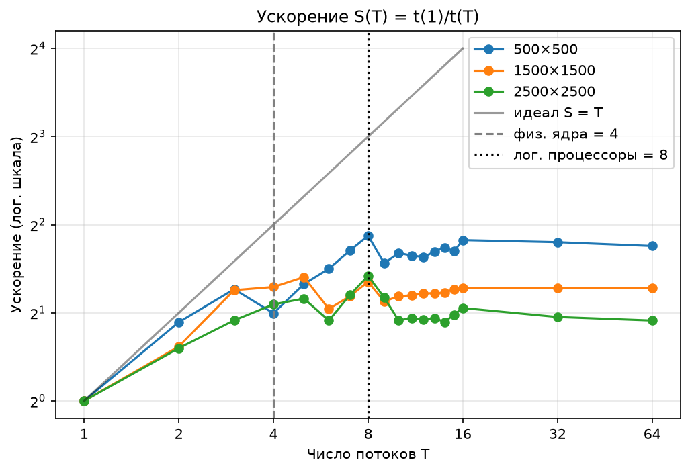
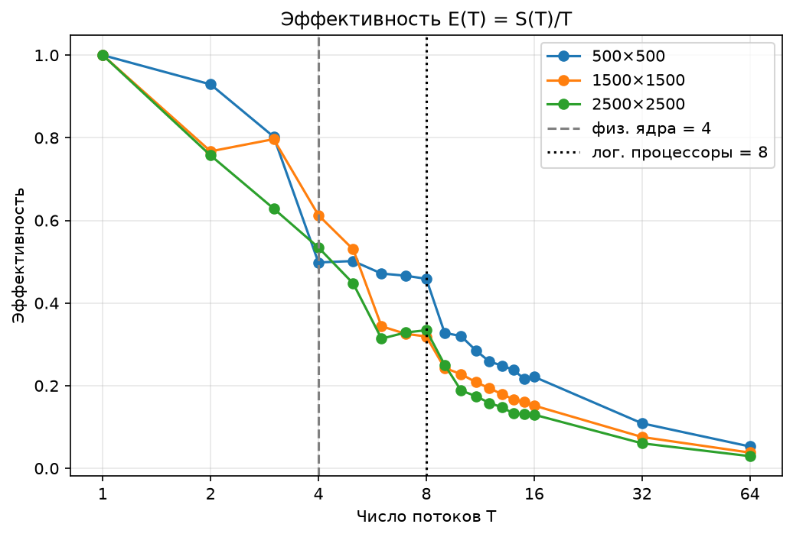
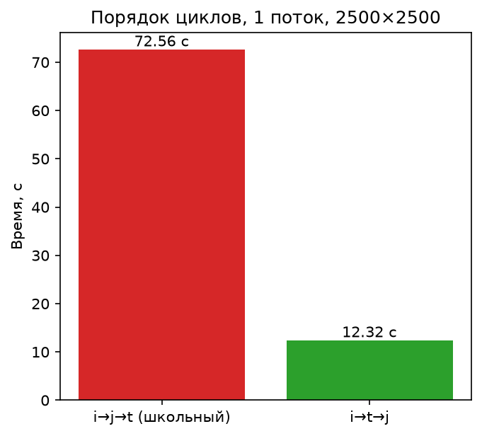

# Многопоточное умножение матриц

Лабораторная работа: параллельное умножение матриц на потоках `std::thread` (C++17), вывод прогресса и исследование оптимального числа потоков.

**Машина для замеров:** ASUS Pro P3540FA-BQ1073, Intel Core i5-8265U (4 ядра / 8 логических процессоров, L3 6 МБ), 8 ГБ DDR4-2400 (один модуль), Windows 11 Pro 25H2, MinGW-w64 g++ 16.2.0, сборка Release (`-O2`).

## Что реализовано

- Умножение A (n×m) на B (m×k) на T потоках; строки результата делятся на непрерывные блоки поровну, остаток раздаётся первым потокам. Работает при любом T ≥ 1, в том числе при T > n.
- Прогресс выводит главный поток; общий счётчик выполненных строк — `std::atomic`.
- Результат собирается целиком в общей матрице C, выводится контрольная сумма, которая сверяется с независимой формулой.
- Замеры: `steady_clock`, 5 повторов на точку, наибольшее и наименьшее отбрасываются, остальные три усредняются.

## Структура репозитория

| Путь | Что внутри |
|---|---|
| `src/matmul.cpp` | программа |
| `CMakeLists.txt` | сборка через CMake (Release по умолчанию) |
| `scripts/run_bench.py` | подбор размеров и автоматические замеры |
| `scripts/analyze.py` | усреднение, S(T), E(T), графики, таблицы |
| `scripts/build_docx.py` | сборка отчёта в Word из `report/REPORT.md` |
| `results/` | сырые данные (`raw.csv`), `summary.csv`, `tables.md`, графики |
| `report/` | отчёт (`REPORT.md`, `report.docx`) |

## Сборка

```
g++ -O2 -std=c++17 -pthread src/matmul.cpp -o matmul
```
или через CMake:
```
cmake -S . -B build -DCMAKE_BUILD_TYPE=Release
cmake --build build
```
Для замеров обязательна оптимизированная (Release) сборка.

## Запуск

```
matmul n m k T [itj|ijt] [прогресс 1|0]
```
Пример: `matmul 2000 1500 1800 8` — A 2000×1500, B 1500×1800, 8 потоков. Порядок циклов по умолчанию `itj` (i→t→j); `ijt` — «школьный» порядок i→j→t. Для матриц до 10×10 результат печатается целиком.

## Замеры

Запускать из корня репозитория, без тяжёлых программ, при питании от сети:
```
python scripts/run_bench.py calibrate
python scripts/run_bench.py run --sizes 500 1500 2500 --logical 8 --physical 4
python scripts/analyze.py
```
Нужны `pandas` и `matplotlib` (`pip install pandas matplotlib`). Отчёт в Word: `python scripts/build_docx.py report/REPORT.md report/report.docx` (нужен `python-docx`).

## Основные результаты

| Размер | Время при 1 потоке, с | Лучшее время, с (T) | Макс. ускорение |
|---|---:|---:|---:|
| 500×500 | 0,073 | 0,020 (T = 8) | 3,67 |
| 1500×1500 | 2,591 | 0,978 (T = 5) | 2,65 |
| 2500×2500 | 12,216 | 4,569 (T = 8) | 2,67 |

- Оптимальное число потоков на этой машине — 8 (число логических процессоров); почти линейный рост только до 2–3 потоков.
- При T больше 8 время не улучшается, на 2500×2500 ухудшается на 30–45%.
- Порядок циклов i→t→j быстрее i→j→t в 5,9 раза (12,32 с против 72,56 с на 2500×2500, 1 поток).
- Малая матрица, почти помещающаяся в L3, масштабируется лучше больших, что указывает на упор в пропускную способность памяти.






Полные таблицы — `results/tables.md`, анализ — в отчёте (`report/`).
